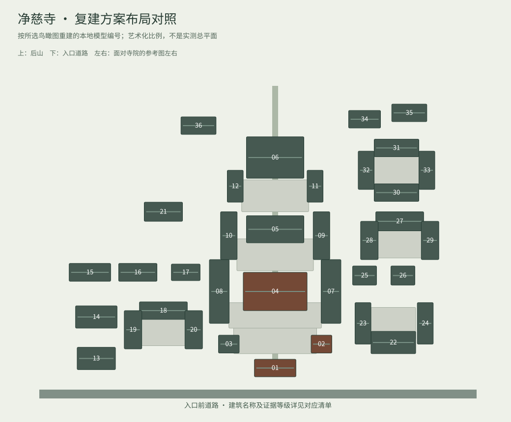

# 净慈寺当前模型逐栋名称对照

核对日期：2026-10-14。共 36 个建筑体块、8 处院落。编号仅用于模型与调查清单对照，不是寺院官方编号。

布局依据用户所选的[木建筑研究中心复建项目效果图](https://www.mu-tect.com/Architecture/118.html)。没有取得逐栋标注的设计总图，**无法可靠给所有房屋逐栋命名**。正式名称与现状粗略关系见[名称调查及来源](jingci-building-names-2026-10-14.md)，图源性质见[出处核查](jingci-reference-provenance-2026-10-14.md)。棕色建筑仅表示名称已有独立资料支持；不表示方案栋位已获设计编号确认。

| 模型编号 | 在参考图中的分区 | 名称核对结果 |
| --- | --- | --- |
| 01 | 前部入口殿 | 山门／金刚殿（粗略轴线关系） |
| 02 | 前院西侧楼阁 | 钟楼／南屏晚钟（粗略侧向关系） |
| 03 | 前院东侧楼阁 | 未确定，保留参考分区名 |
| 04 | 中轴宽大重檐殿 | 大雄宝殿（粗略轴线关系） |
| 05 | 中轴后殿 | 未确定；三圣殿为名称候选，尚无方案编号映射 |
| 06 | 后部高台三檐大阁 | 未确定，保留参考分区名 |
| 07 | 中院西庑 | 未确定，保留参考分区名 |
| 08 | 中院东庑 | 未确定，保留参考分区名 |
| 09 | 中后院西廊 | 未确定，保留参考分区名 |
| 10 | 中后院东廊 | 未确定，保留参考分区名 |
| 11 | 高台西廊 | 未确定，保留参考分区名 |
| 12 | 高台东廊 | 未确定，保留参考分区名 |
| 13 | 参考图左侧前部堂楼一 | 未确定，保留参考分区名 |
| 14 | 参考图左侧前部堂楼二 | 未确定，保留参考分区名 |
| 15 | 参考图左侧后排房一 | 未确定，保留参考分区名 |
| 16 | 参考图左侧后排房二 | 未确定，保留参考分区名 |
| 17 | 参考图左侧后排房三 | 未确定，保留参考分区名 |
| 18 | 参考图左侧围院后房 | 未确定，保留参考分区名 |
| 19 | 参考图左侧围院外厢 | 未确定，保留参考分区名 |
| 20 | 参考图左侧围院内厢 | 未确定，保留参考分区名 |
| 21 | 参考图左侧后山房 | 未确定，保留参考分区名 |
| 22 | 参考图右侧前庭正房 | 未确定，保留参考分区名 |
| 23 | 参考图右侧前庭内厢 | 未确定，保留参考分区名 |
| 24 | 参考图右侧前庭外厢 | 未确定，保留参考分区名 |
| 25 | 参考图右侧中部楼一 | 未确定，保留参考分区名 |
| 26 | 参考图右侧中部楼二 | 未确定，保留参考分区名 |
| 27 | 参考图右侧围院后房 | 未确定，保留参考分区名 |
| 28 | 参考图右侧围院内厢 | 未确定，保留参考分区名 |
| 29 | 参考图右侧围院外厢 | 未确定，保留参考分区名 |
| 30 | 参考图右后院前房 | 未确定，保留参考分区名 |
| 31 | 参考图右后院后房 | 未确定，保留参考分区名 |
| 32 | 参考图右后院内厢 | 未确定，保留参考分区名 |
| 33 | 参考图右后院外厢 | 未确定，保留参考分区名 |
| 34 | 参考图右后山房一 | 未确定，保留参考分区名 |
| 35 | 参考图右后山房二 | 未确定，保留参考分区名 |
| 36 | 参考图左后山房 | 未确定，保留参考分区名 |

寺内另有济公殿（济祖殿）、运木古井、观音殿、演法堂、永明塔院等可查名称，其中项目图库实拍可读到“济公殿”“运木古井”。它们目前无法可靠对应到方案图某一编号，因此没有把这些名称放到未知房屋上。后部高阁保留“后部高台大阁”，不套用历史上千佛阁等名称。

本地图标交互保持七个分区探索点，避免给 35 栋未知房屋铺满标签。现有四张实景热点照片保留并说明现状与方案可能不同；新增三分区未对应实景照片，明确显示暂无实景照片。
