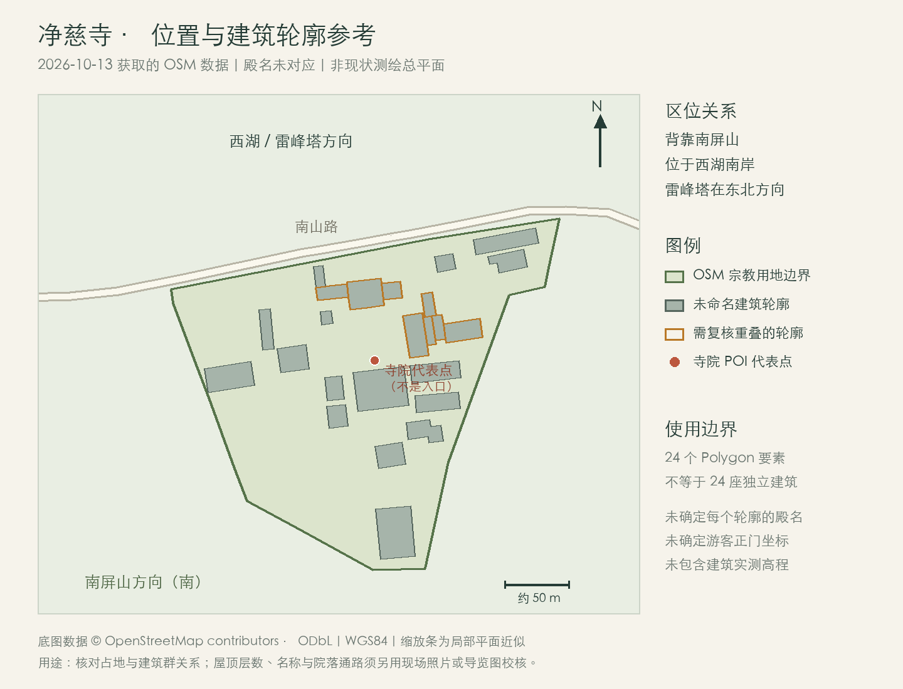
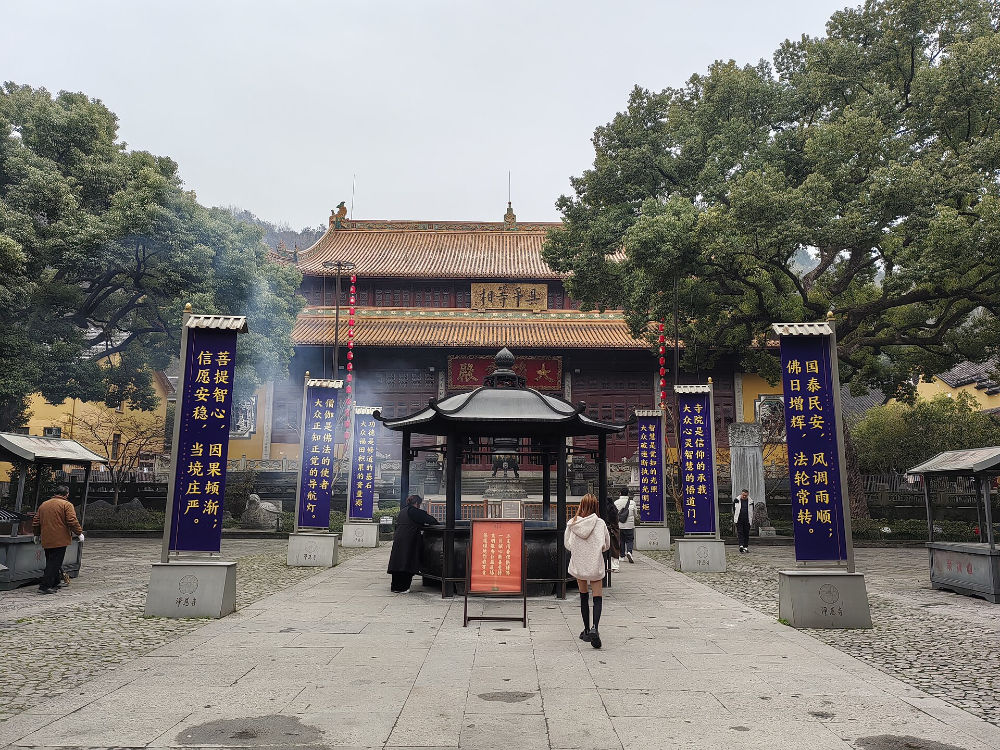
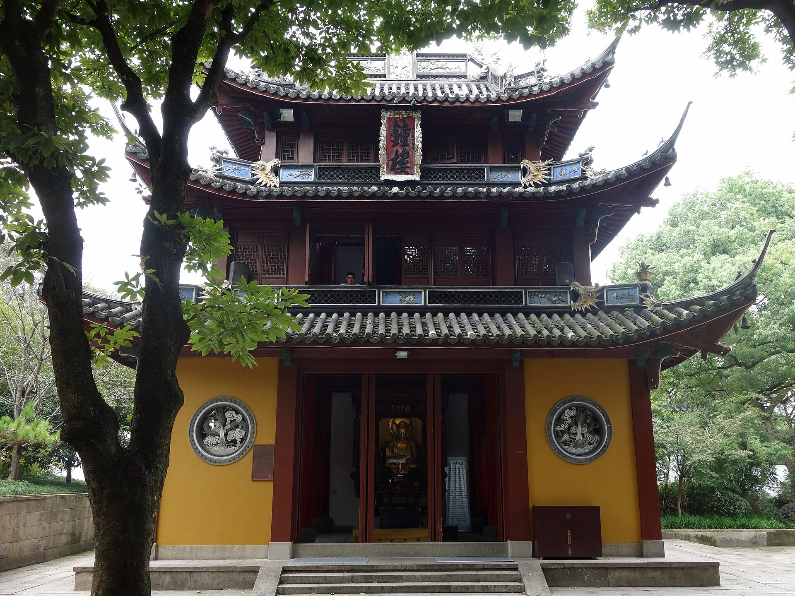

# 净慈寺建模前调查

调查日期：2026-10-13。范围：位置、可确认的布局关系、建筑外观和数据缺口。本轮只整理资料，未修改应用中的景点或模型。

## 1. 位置与山湖关系

净慈寺位于西湖南岸的南山路 56 号、南屏山中峰慧日峰下。应表现为临路、背山的建筑院落组团；寺院后方接南屏山林坡。位置依据：[杭州年票地址公告（2020）](https://hznews.hangzhou.com.cn/chengshi/content/2020-11/18/content_7856474.htm)、[杭州市文物考古所调查（2023）](https://hznews.hangzhou.com.cn/wghz/content/2023-02/10/content_8467924.htm)。

本次取得的 OSM 寺院代表点为 **经度 120.1443406、纬度 30.2311307**，来源为 [node/4427428610，version 7](https://www.openstreetmap.org/node/4427428610)。它不是已确认的山门坐标。寺院位于雷峰塔西南方向，两者同在西湖南岸，南山路与南岸陆地构成其间的空间；[从雷峰塔拍摄的照片（2008）](https://commons.wikimedia.org/wiki/File:Hangzhou-west_lake_wiew_from_leifeng_pagoda_-_panoramio_-_HALUK_COMERTEL_(7).jpg)可直观看到道路—寺院—山林的关系。

院界参考为 [OSM way/445291616，version 5](https://www.openstreetmap.org/way/445291616)，约覆盖经度 120.142689–120.145845、纬度 30.229661–30.232125。它是社区地图的宗教用地边界，不能视为文保测绘院界。代表点与院界均在现有西湖 DEM 范围内。

## 2. 布局：已确认的关系与未确认的细节

| 对象 | 本次可确认的关系 | 当前证据边界 |
| --- | --- | --- |
| 前部入口建筑 / 金刚殿 | 2011 年实地报道记为前排建筑；2025 年山门照片有“敕建净慈禅寺”竖匾 | 山门、金刚殿、天王殿是否为同一单体的不同称呼，不能仅据文字拆成三栋房屋 |
| 大雄宝殿 | 中部核心主殿；前有石铺庭院、香炉、台阶与石台基 | 各建筑的实测长宽高、柱网及与 OSM 轮廓的对应未确认 |
| 钟楼 | 报道明确位于金刚殿西侧，1986 年重建 | 尚未锁定对应的 OSM Polygon；不能按传统对称规则复制同形鼓楼 |
| 放生池 | 杭州政府 2021 年介绍列为山门前的设施 | 现状池岸、尺寸、入口前场完整序列未确认 |
| 济公殿 / 济祖殿、运木古井 | 政府和实地报道列出寺内这些节点 | 名称对应、现状位置、井亭形式和相邻关系待带标注的导览图或现场照片核验 |
| 观音殿、演法堂 | 2021–2022 年考古区位于寺院西南部，东临这两处建筑 | 不能由考古遗迹反推其今天的屋顶、层数或院落形态 |

依据：[2011 年实地图文](https://ori.hangzhou.com.cn/ornews/content/2011-04/27/content_3706962.htm)、[2017 年钟楼报道](https://www.hzzx.gov.cn/cshz/content/2017-01/05/content_6436486.htm)、[杭州政府英文介绍（2021）](https://eng.hangzhou.gov.cn/art/2021/3/10/art_811216_58875578.html)、[考古调查（2023）](https://hznews.hangzhou.com.cn/wghz/content/2023-02/10/content_8467924.htm)。旧报道用于支持局部关系，2025 年照片只确认其视野内外观；本轮没有取得带北向、比例尺和完整殿名的现状总平面。

图中 24 个未命名 Polygon **不等于 24 座独立建筑**。其中六对轮廓存在包含或边界相交，需要先判定主体、屋顶层级或重复映射，再用于建模。本轮保留全部原始轮廓，没有擅自去重或赋予殿名。附近 `node/13286682662`、`node/13286682670` 均在寺院院界北侧外，不能作为净慈寺入口。[详细数据复核](./jingci-layout-sources-2026-10-13.md)

布局参考图：原始 WGS84 坐标以局部等距近似投影绘制，北向朝上；缩放条仅供占地比例参考。数据 © [OpenStreetMap contributors](https://www.openstreetmap.org/copyright)，ODbL。

## 3. 房屋造型

| 单体 | 直接可见、适合保留的特征 | 不应凭空补出的内容 |
| --- | --- | --- |
| 大雄宝殿 | **单层重檐**，两层宽出檐；黄 / 橙黄色琉璃屋面；红褐色木构、格扇；灰白石台基、宽石阶及中央石刻 | 重檐不是两层楼；精确屋脊高度、斗拱等级和雕刻尺寸尚无测绘依据 |
| 山门 / 入口殿 | 灰瓦坡屋面，黄色墙体，深红木门；中央竖匾，两侧圆窗；门前石狮与石阶 | 暂不拆成连续三座入口殿；侧部开间与完整平面未知 |
| 钟楼 | 政府资料记为**两层、三重檐**楼阁；照片可见灰瓦、上翘檐角、红木栏杆、下部黄色墙体；上层悬钟、下层为地藏殿 | 英文 `hipped roof` 不能自动等同中文“歇山”；精确屋顶分类需侧立面或中文建筑资料 |
| 附属建筑 | 2008 年俯瞰可见多个较低的灰瓦、白墙 / 黄墙体量，建筑间有树木遮挡 | 不能用旧照片推定 2026 年完整布局；每栋屋顶、层数、用途须分别确认 |

大雄宝殿“单层重檐”的文字依据为 [2011 年报道](https://ori.hangzhou.com.cn/ornews/content/2011-04/27/content_3706962.htm)，色彩、台阶和立面由 [2025 年照片](https://commons.wikimedia.org/wiki/File:20250310_Daxiong_Baodian,_Jingci_Si.jpg)交叉核对。屋面呈重檐歇山式的判断来自照片外形，未作为官方建筑分类或测绘结论。

Yumeto，2025-03-10，[原图及许可](https://commons.wikimedia.org/wiki/File:20250310_Daxiong_Baodian,_Jingci_Si.jpg)，CC BY-SA 4.0；本地副本缩放。

Tyg728，2016-10-06，[原图及许可](https://commons.wikimedia.org/wiki/File:%E5%87%80%E6%85%88%E5%AF%BA%E9%92%9F%E6%A5%BC.jpg)，CC BY-SA 4.0；本地副本缩放。

另已保存山门（2025）、大雄宝殿正面（2016）和雷峰塔方向俯瞰（2008）三张参考照片。完整作者、日期、许可与单体拆解见 [建筑结构调查](./jingci-building-structure-2026-10-13.md)。照片是带日期的外观证据，不能保证照片外或其后改建部分的现状。

## 4. 后续建模时应遵循的边界

可先围绕**入口殿—大雄宝殿—钟楼—石庭院—背后林坡**建立有照片依据的核心区；其余建筑先按可核对的占地和群落关系处理，待补充导览图后再命名、细化。全景和单景应复用同一组建筑造型，继承现有项目的视角过渡方式。这里是建模建议，本轮没有生成 Three.js 模型。

需要继续核验：各殿名与 OSM 轮廓的对应、游客正门坐标、后部建筑与古井的现状关系、台阶通路、每栋实测尺寸和台地高程。30 米 DEM 不能提供寺院台基与建筑的可靠细部高程。

宋代 / 五代遗迹 JZ3 的八边形台基和“北偏西 7°”来自西南部考古发掘，**不能用作现状寺院整体轴线，也不能直接复原成今天的五百罗汉堂**。改复建规划图同样须确认完成情况后才能当作现状依据。[考古原始报道](https://hznews.hangzhou.com.cn/wghz/content/2023-02/10/content_8467924.htm)

## 5. 原始资料

- [OSM 原始 XML](./jingci-layout-source.osm)：保留院界、节点、建筑、道路与来源版本。
- [建筑轮廓 GeoJSON](./jingci-building-footprints.geojson)：24 个未命名 WGS84 Polygon，原始 OSM 属性保留。
- [地图与拓扑复核](./jingci-layout-sources-2026-10-13.md)。
- [官方布局与现状 / 历史区分](./jingci-campus-research-2026-10-13.md)。
- [建筑结构与图片授权](./jingci-building-structure-2026-10-13.md)。
