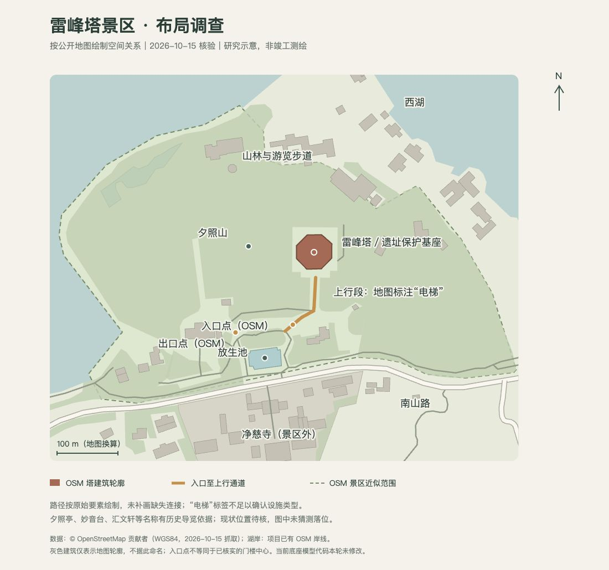

# 雷峰塔景区空间布局调查（2026-10-15）

本文件前半记录改造前的空间调查与问题诊断，末尾补记用户授权后的实施结果。调查与建模均不把推断当作实测，目标是明确塔下山坡、保护性基座与游线的关系。

## 布局图与原始记录

[可缩放 SVG](leifeng-scenic-layout-2026-10-15.svg) 使用相同米制比例绘制经纬度；北在上，橙线是原始地图中入口至上行段的连接，并未补画缺失路径。它表达地图空间关系，不是官方总平面、运营导航或测绘成果。

- 本轮保存的 [OSM 原始 XML](leifeng-references/leifeng-osm-2026-10-15.osm.xml)：请求框 `120.140,30.231,120.149,30.237`，共 1801 个节点、145 个 way。API 会附带相交 way 的框外节点，因此不能以文件全部节点的外包范围当作景区范围。
- 雷峰塔 `way/229726934`、雷峰夕照公园近似范围 `way/975360504`、夕照山 `node/5580634151`、放生池 `way/62124950`。
- 入口点 `node/13286682662`（120.1446484,30.2328109，`entrance=yes,access=customers`），出口点 `node/13286682670`（120.1436703,30.2326964）；入口标签不证明门楼中心位置和形状。
- 上行连接 `way/975357010`，标为“电梯”的阶梯 `way/340652169`，分支 `way/1448129176`。地图中上行段末端到塔建筑轮廓仍缺一段连接，不能用直线补齐后声称是真实步道。
- 雷峰塔 OSM 建筑轮廓约 58×56 米，仅作开放地图的尺度对照，不将其直接认作实测塔基尺寸。图中灰色建筑未擅自命名。

## 结论先行

- 雷峰塔不是一座放在独立高台上的孤立塔。清华同衡/清华大学建筑设计院的项目说明明确写出：新塔选在夕照山东侧的古塔遗址上，跨遗址建设；新塔基座同时是古塔遗址的保护性建筑，塔身才是供游客登高观湖的部分。[清华同衡《雷峰新塔设计》](https://dauh.thupdi.com/project/view?id=1782)（项目页当前访问，设计单位和项目负责人见页面第 62–84 行）。因此，现状中塔下应建模为“山体坡面 + 保护性基座/遗址展示层 + 上部塔身”的连续系统，不能用一个脱离地形、四面等高的大体量墩台替代。
- 雷峰塔位于西湖南岸夕照山的雷峰上；杭州文旅官方资料确认“依山临湖”，并说明古塔遗址采用玻璃天棚覆盖。[杭州市文化广电旅游局《雷峰塔（雷峰夕照）》](https://wgly.hangzhou.gov.cn/art/2022/12/1/art_1229696389_58943150.html)。杭州网专题资料补充了保护罩、塔身、塔刹的竖向分层，但其“地平线以下 9.7 米”的媒体措辞与保护罩、塔身、塔刹的竖向分层关系含混；本调查不把该数字用于推算地面以上挡墙、基座或平台高度。[杭州网《带你了解杭州雷峰塔》](https://z.hangzhou.com.cn/2022/syjy/content/content_8421276.html)
- 公开一手资料没有给出当前景区总平面、门楼、广场、扶梯坡道和配套建筑的可核验测量图。南山路入口及其门楼/广场的具体形状、塔外自动扶梯的精确路线、景区内部设施相对方位，不能只凭旅游攻略或效果图定型。

## 证据与空间关系

| 空间对象 | 当前可确认的关系 | 证据等级与边界 |
| --- | --- | --- |
| 西湖、南岸、夕照山 | 雷峰塔在西湖南岸的夕照山/雷峰上，形成“依山临湖”的湖山关系；夕照山属于南山山系。 | 杭州市文旅官方景点页；西湖管委会公开环境影响报告对南山系列列出夕照山，并将雷峰塔遗址列为代表性文化史迹。[报告 PDF](https://westlake.hangzhou.gov.cn/module/download/downfile.jsp?classid=0&filename=3c291a27ea6b4ff5be179b71b0c2b759.pdf) 第 22–24 页。山体具体等高线与塔址高程未在本调查中取得。 |
| 古塔遗址与新塔 | 新塔位于夕照山东侧古塔遗址上；跨遗址建设，基座承担遗址保护建筑功能。 | 设计单位项目说明，属于最强的设计/空间证据。它支持“基座与遗址/山体整合”，不提供现状外围平台边界的测量坐标。 |
| 保护罩与遗址展示 | 保护罩覆盖地下古塔遗址；新塔由保护罩、塔身、塔刹构成。 | 杭州市文旅官方页 + 杭州网专题。杭州网原文把“地平线以下 9.7 m”与保护罩/塔身分层并列叙述，媒体措辞不足以判定其对应的完整构造范围；不把该数字用于推算地上挡墙高度或整个基座高度。遗址内部展示布局、罩体地面边缘及栏杆尺寸未知。 |
| 塔身、楼梯、电梯 | 新塔内部有楼梯和电梯，功能定位是登高观览西湖；杭州网资料称设有 4 台观光电梯。 | 清华同衡项目页确认“楼梯 + 电梯”和登高观景功能；杭州网为补充。电梯数量、扶梯是否位于塔外或仅为建筑内部通行、游客实际动线仍需现场或竣工资料确认。 |
| 景区边界 | OSM 的 `leisure=park,name=雷峰夕照` 面要素包围塔区及夕照山林地，当前数据范围约 30.231655–30.236046 N、120.140658–120.148464 E；这只能作为开放地图上的近似边界。 | [OpenStreetMap 原始 API map bbox](https://api.openstreetmap.org/api/0.6/map?bbox=120.14,30.22,120.16,30.24)，数据抓取日 2026-10-15。OSM 是社区编辑数据，版本/完整性与边界法律效力均未知，不能替代景区红线图。 |
| 南山路 | OSM 将南山路标为景区西南/南侧的城市道路；其道路要素沿塔区南侧通过。 | OSM 原始 XML，WGS84 经纬度。路缘、入口广场和景区红线没有通过官方总平面核定。 |
| 南山路入口、门楼、售票/检票空间 | 地图服务能找到南山路 15 号及若干“南门/南1–南4门”标注，但本调查没有找到由景区或政府发布的当前门楼总平面。 | 仅作待核实线索：百度/高德等地图条目是二手地图数据，不能作为建模事实。入口门楼的朝向、数量、广场深度和是否有独立建筑均未知。 |
| 历史导览中的配套景观/服务点 | 2012 年杭州日报报道景区推出导览地图，并点名汇文轩、妙音台、夕照亭等景点/设施；因此这些名称有明确日期的一手导览存在证据。 | [杭州日报 2012-11-26 原始报道](https://hznews.hangzhou.com.cn/chengshi/content/2012-11/26/content_4491055.htm)。报道证明当时导览命名和存在，不足以证明 2026 年仍在原位，也没有提供可用于建模的坐标/尺寸。 |
| 塔外步道与上行节点 | OSM 在塔区记录了多段 `highway=footway` 与 `highway=steps`；一段名为“电梯”的阶梯要素从约 30.2330711,120.1450116 延伸至 30.2335066,120.1450384，另有步道从南侧较低处接到约 30.2330711,120.1450116。 | 这是地图要素观察，不是现场测量；“电梯”是 OSM 名称标签，不能单独证明设施是自动扶梯、观光电梯或仍在运营。步道连接关系可用于提出假设，不能直接用于游客导航。 |
| 夕照山林地 | OSM 在塔区外围和景区面内记录多个 `natural=wood` 面；清华同衡设计说明指出夕照山林木苍郁，选址利用古塔遗址处树木较少的位置以减少植被破坏。 | 设计说明 + OSM 林地要素相互印证“塔址位于林地山体中的开敞遗址点”，但未取得树种、冠幅、当前树线或真实坡度测量。 |
| 放生池与水体 | OSM 记录名为“放生池”的 `natural=water` 面，约 30.2321493–30.2324762 N、120.143888–120.1444559 E；该水体位于塔区南/西南低处，相对塔址约在西南方向。 | OSM 原始要素；名称和几何为地图标注，未由景区官方当前导览图复核。另有一个未命名水体要素，不能擅自命名或纳入模型。 |
| 净慈寺与景区外邻接 | OSM 记录净慈寺面位于雷峰塔区南侧/西南侧；公开旅游资料也把雷峰塔与净慈寺作为同一区域游览关系。 | 净慈寺本体不属于雷峰塔景区内部配套建筑；西湖全景可表达邻接地标，但不能把寺院建筑并入雷峰塔景区边界。 |

## 改造前全景代码的诊断边界

对现有 `src/west-lake/leifeng-pagoda/model.js` 的只读检查显示，`createLeifengOverviewFoundation` 使用 `platformRadius = 0.34`、`outerRadius = 0.48`，内部用 `getHeight` 采样外圈，并用 `Math.max` 托平基座标高；另有一条沿 `+z` 的矩形 approach 通道。按当前 `horizontalScale=0.0025` 换算，平台水平直径约 272 m、外圈直径约 384 m，南侧通道宽约 88–104 m、水平长度约 112 m，远端距塔中心约 232 m。这里的数值是当前程序世界单位映射后的诊断，不是雷峰塔现场尺寸。

离线用当前 DEM 与生产三角插值复算，中心样本约 43.1 m，采样区域最高点约 53.1 m，最低点约 12.1 m；统一平台因此比塔中心原地面再抬高约 10 m 的源数据高差，而 World 又采用 4 倍垂直夸张。这些是 DSM/DEM 样本，不能认作塔区实测地坪标高。当前测试只要求平台不穿过采样高点，会保护“最高点托平”策略，却不能证明布局和比例合理。

因此，当前画面中的“大墩子”和南侧长通道应先被视为独立的展示级附加土坡/平台表达：代码采样地形只保证视觉贴地，`Math.max` 托平也会把局部地形抬到统一基准；它们不能被解释为真实保护罩、塔座外墙或景区广场的测量结果。该诊断支持后续把代码表达与真实布局重新对照，但本轮不实施代码修复。

## 关于“塔下大墩子”的建模判断

已确认的最小空间层级应是：

1. 夕照山自然地形和林地基底，塔址处为山体中的遗址开敞点，而非独立人工平顶岛。
2. 古塔遗址及其玻璃保护罩/遗址展示层，位于新塔基座之内或下方。
3. 新塔保护性基座与外部可达平台、入口坡道/台阶共同形成登塔起点；其边界应随山坡和游线变化，而不是四边高度一致的厚墩。
4. 五层八面塔身与塔刹从基座上升；楼梯、电梯属于登塔系统，不能在塔外景观中被替换为一条未经证实的巨大竖向实体。
5. 塔前/塔周步道、树木和低矮园林空间，再向南侧连接景区入口和南山路；放生池是低处独立水体，不能贴到塔基下方充当护城池。

这里的第 3–5 层是由设计定位、官方景点关系和 OSM 几何共同推断出的建模层级，不是现状竣工测绘。设计方资料没有公开完整景区总平面，外围平台、铺地边界以及挡墙/台阶高度与级数仍需核实。

## 地图、照片与投影注意

- OSM API 返回的是 WGS84 经纬度（EPSG:4326）要素，来源时间为本次抓取的 2026-10-15；经纬度应先投影到本地米制坐标后再计算距离，不能把经度差直接当作米。WGS84 OSM 坐标也不能直接与高德/百度坐标比较，因为后者可能使用 GCJ-02、BD-09 或服务端转换；当前 OSM 雷峰塔中心约 30.23388, 120.14501 与项目使用的塔址相吻合，不能因未经坐标系转换的地图服务坐标差异而移动塔位。OSM 的面、道路和名称有编辑延迟、漏绘及标签语义不一致风险。
- 西湖管委会环境影响报告是规划/项目材料，不是雷峰塔景区竣工总平面；其中的西湖文化景观和山系叙述可支持宏观空间关系，不能反推出塔区内部尺寸。
- 清华同衡项目页发布于 2013-07-10，第四张为[雷峰塔设计剖面图](https://img.thupdi.com/project/2013/07/1782-ff648dd2-a130-499a-9eac-2c5139ac1019.jpg)。浏览器已读取原图：下部保护空间跨越古塔遗址，外围平台栏杆和上部塔身分层明确，支持将基座表达为有内部空间的保护建筑。图为设计剖面，不作为当前竣工标高、植被、入口广场或铺装的证据；低清标注不用于反算构件尺寸。版权归原设计/发布方，项目未复制该图为模型纹理。
- 杭州网专题配图的拍摄/制作年代没有在页面逐图提供可核验的摄影测量信息；只能用于外观和保护罩概念核对。2012 年杭州日报导览报道是有日期的一手命名/导览证据，但不是现状测绘图。已有项目资料中的 Wikimedia 实景照片可继续作为独立视觉佐证，但应保留其文件页的作者、上传/拍摄年代字段，不把透视照片当作正射图。
- 任何卫星图、街景图、旅游手绘图和效果图都存在透视、拼接、日期和坐标基准问题；本调查没有用它们推算建筑尺寸。

## 后续建模前需要的实测/核验

1. 取得景区管理方当前导览图或测绘总平面，核定景区红线、南山路入口/门楼、售票检票区、外部广场和主要步道的真实连接。
2. 现场或竣工资料核验塔基外缘、玻璃保护罩地面边界、遗址展示层入口、台阶/坡道方向及与山坡的高差；至少建立若干实测断面，避免把地下保护罩数字误建成地上墩台。
3. 核验 OSM “电梯”阶梯标签对应的实际设施，区分塔内电梯、塔外自动扶梯、普通步道和维护通道；记录开放状态与游客动线的日期。
4. 以 RTK/全站仪、公开正射影像或景区提供的有坐标图纸核定塔址、放生池、南山路和净慈寺的相对位置；明确采用的坐标系、投影和高程基准。
5. 对配套建筑只在取得当前官方名称及位置证据后建模。2012 年杭州日报导览已确认“汇文轩、妙音台、夕照亭”等名称在当时官方/景区导览中存在；“放大光明阁、如意苑、藕香居”等名称也见景区介绍或导游材料，但本调查没有得到这些点位的当前方位和独立一手平面证据，不应仅凭名称把它们放入 2026 场景。

## 来源清单（按证据用途）

1. 清华同衡建筑与城市遗产研究所，《雷峰新塔设计》：选址、跨遗址保护性基座、登高观景功能、楼梯/电梯、林木保护设计意图。[原始项目页](https://dauh.thupdi.com/project/view?id=1782)
2. 杭州市文化广电旅游局，《雷峰塔（雷峰夕照）》：西湖南岸夕照山、依山临湖、遗址玻璃天棚与官方景点叙述。[官方页面](https://wgly.hangzhou.gov.cn/art/2022/12/1/art_1229696389_58943150.html)
3. 杭州市西湖风景名胜区管委会公开环境影响报告：夕照山属于南山系列、雷峰塔遗址为西湖文化景观代表性文化史迹、景观空间保护关系。[政府 PDF](https://westlake.hangzhou.gov.cn/module/download/downfile.jsp?classid=0&filename=3c291a27ea6b4ff5be179b71b0c2b759.pdf)
4. 杭州网《宋韵迹忆·带你了解杭州雷峰塔》：重建时间、钢骨铜身、保护罩/塔身/塔刹分层和“地下 9.7 米”原文；该数字已按语义边界谨慎使用。[官方媒体专题](https://z.hangzhou.com.cn/2022/syjy/content/content_8421276.html)
5. 杭州日报 2012-11-26：《雷峰塔景区推出导览地图》类报道：有日期的一手导览命名证据，点名汇文轩、妙音台、夕照亭等；不提供当前测量坐标。[原始报道](https://hznews.hangzhou.com.cn/chengshi/content/2012-11/26/content_4491055.htm)
6. OpenStreetMap 原始 API 当前 bbox：景区面、雷峰塔、夕照山、南山路、放生池、净慈寺及步道/阶梯要素。[API 原始 XML](https://api.openstreetmap.org/api/0.6/map?bbox=120.14,30.22,120.16,30.24)，抓取日 2026-10-15。

## 调查时提出的改造建议

先移除额外的大圆盘/宽斜坡表达，复核微缩塔相对湖山的水平尺度；保留并重做真实的遗址保护基座、外部平台与栏杆，让夕照山的不规则山脊、林坡和局部开敞地围绕塔址。随后按已核验连接补入南侧入口通道、上行设施及分支步道、独立放生池；亭阁与服务建筑待方位证据补齐后再落位。全景和单景共用同一空间核心，继续验证飞入视角、返回渐变、边缘接地和低角度可见性。

## 授权后的实施记录（2026-10-15）

用户随后授权按调查方案调整。本地模型已移除直径数百米的统一圆盘和宽坡，保留塔的原 WGS84 位置，并将 World 统一比例改为 0.005。塔体、保护性台基、外部平台、步道和放生池构成共享核心；单景另有闭合地块，World 只修正原有地表，不重复放置整块单景山体。

园区边界、池塘与十段园内步道由本页原始 OSM 快照提取，局部高程来自现有 Copernicus DEM，生成脚本为 `scripts/generate-leifeng-site.py`。入口保留地图节点并连接上行步道，不虚构门楼。上行段缺失的末端连接标为艺术化补接，步道宽度、局部台地及池岸整理均不是实测结果；“电梯”标签没有被解释成已核验的设施类型。历史亭阁仍待位置证据后再做。

平台附近同时削平高侧、垫平低侧，再渐接原始展示地形，避免 30 米高程与四倍垂直夸张形成高挡墙。World 使用同一高度场，分次地形调整保留净慈寺既有接地；两景共享核心的入场首帧投影保持一致。实际渲染三角面已检查台阶踏面、步道、平台、池岸与树根。源 DEM 未修改，数据可重复生成。验收结果与预览见[场景记录](west-lake-scenic-scenes.md)。以上为展示模型改造，不构成真实景区导航或竣工复原。

