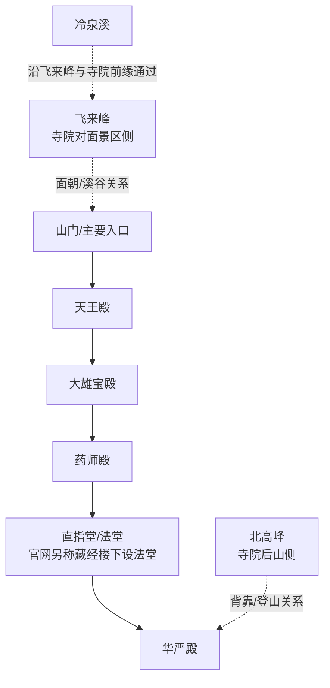

# 杭州灵隐寺总平面与建筑布局资料（截至 2026-10-04）

本页只记录可追溯的资料和可用于后续建模的关系。它不是测绘图，也不把历史平面、景区范围或 OSM 的未命名建筑猜成今天的寺院建筑。当前项目里的 `node/1218588822`（120.0967987, 30.2427953）只是 OSM 的“灵隐寺”兴趣点，不能代替寺院总平面。

## 已确认的空间关系

灵隐寺官网“寺院导览”页的页面说明写明：寺院“背靠北高峰，面朝飞来峰，两峰挟峙”。杭州文旅官方的灵隐景区介绍把“灵隐寺和飞来峰”作为灵隐景区内容。2025 年西湖风景名胜区灵隐管理处通告又明确把“灵隐飞来峰景区”作为包含灵隐寺、永福寺、韬光寺的管理/游览范围。因此，建模时应把寺院建筑群、飞来峰造像游览区、永福寺和韬光寺分成不同层级；它们同属较大的景区语境，不等于一个寺院院落。

官网寺院介绍给出的现代中轴顺序是：

> 山门/入口 → 天王殿 → 大雄宝殿 → 药师殿 → 直指堂（法堂） → 华严殿。

官网另一版介绍将中轴末段写作“藏经楼（下设法堂）→华严殿”。此次直接点读官网交互导览图的“直指堂（法堂）”弹窗后，已核实第四殿是同一建筑的三层关系：顶层为藏经楼，中层为法堂，底层为文物展厅。因此这里不应建成两个连续、独立的现代主殿。可以稳定采用的五个主要层级仍是：天王殿、大雄宝殿、药师殿、直指堂（顶层藏经楼／中层法堂／底层文物展厅）、华严殿。官方文章还说天王殿是山门内第一重殿，天王殿后门正对大雄宝殿。

### 朝向与地势

不能把这条中轴默认为正南北。官网只给出“背靠北高峰、面朝飞来峰”，没有正南北断言。按 OSM 主 API 当前带名称建筑多边形的质心计算，天王殿 → 大雄宝殿 → 药师殿 → 华严殿的后进方向约为真北偏西 18–19°（约 341–342° 方位角）；这是由 WGS84 多边形推得的现状近似方向，不是测绘定向，也不应替代后续实测。建筑之间的逐进关系显示为逐级向北、略向西；官网交互导览图中华严殿弹窗对后段位置/地势的说明支持这种逐进表现，但没有公开每一级台阶高程或台基标高。因此模型可保留沿中轴逐进的台地/平台表达，不应把它写成实测高差。

### 两侧建筑（只写能由来源支持的相对位置）

官网文章确认中轴两侧附有五百罗汉堂、济公殿、联灯阁、华严阁、大悲楼、方丈室/方丈楼等；它没有在文字中给出每一座的东西侧坐标。OSM 主 API 的建筑多边形可以补充相对位置，但这些建筑多边形的来源标签主要为 `Bing`、`own photos`、`tourist map` 或未注明，故以下是“OSM 映射关系”，不是官方测绘结论：

| 建筑 | OSM 对象 | 当前 OSM 质心（WGS84，lon, lat） | 相对中轴的可用判断 |
|---|---|---|---|
| 五百罗汉堂 | `way/195072255` | 120.0960796, 30.2424271 | 位于天王殿一带的西侧/西南侧；OSM 标签说明为佛像集中、卍形建筑。 |
| 济公殿 | `way/434365308` | 120.0968364, 30.2436813 | 位于药师殿附近的东侧；不要把它移到五百罗汉堂一侧。 |
| 联灯阁 | `way/676045745` | 120.0974096, 30.2431594 | 位于大雄宝殿—药师殿前段的东侧。 |
| 大悲楼 | `way/676045743` | 120.0973143, 30.2434029 | 位于药师殿前后段的东侧。 |
| 方丈楼 | `way/676045757`（带 `multipolygon` 关系 `relation/9388591`） | 120.0975517, 30.2438159 | 位于药师殿后段的东侧、较后方。 |
| 灵隐寺文物展厅 | `way/434366739` | 120.0963222, 30.2439803 | 位于药师殿与华严殿之间；可作为官方导览图所说“直指堂/法堂”底层文物展厅的候选外廓，但 OSM 名称仍是“灵隐寺文物展厅”，不得未经核实改名为法堂。 |
| 华严阁 | 暂未在此次 OSM 主 API 窗口找到带名称的建筑多边形 | — | 只确认其为官网/历史资料中的建筑名称；相对坐标留空。 |
| 钟楼、鼓楼 | 暂未在此次 OSM 主 API 窗口找到带名称的建筑多边形 | — | 官方日文现状导览确认在天王殿两侧，西为鼓楼、东为钟楼；实际外廓、坐标与尺寸仍待核。 |

“东西两侧”是官网对建筑群的总体描述。除钟鼓楼由官方日文导览直接确认东西关系外，上表的东/西判断来自 OSM 坐标与已命名主殿多边形。没有来源支持的建筑不要为了画对称而补齐。[官方钟鼓楼导览](https://jp.lingyinsi.org/list_161.html)

## 官方与政府资料

1. **杭州灵隐寺官网：寺院导览（交互导览图）**：<https://lingyinsi.org/map/default.html>。页面 `<meta description>` 明确写“背靠北高峰，面朝飞来峰，两峰挟峙”；这是本调查找到的官方导览入口。它是交互瓦片图，不是一个带公开下载链接的静态 CAD/测绘平面图，故本页不把页面截图像素当作坐标数据。
2. **杭州灵隐寺官网：寺院简介/主要建筑**：<https://www.lingyinsi.org/detail_22_673.html>。明确写现代主要建筑以“天王殿、大雄宝殿、药师殿、直指堂（法堂）、华严殿”为中轴，两边附五百罗汉堂、济公殿、联灯阁、华严阁、大悲楼、方丈室等。
3. **杭州灵隐寺官网：境内导览文章**：<https://www.lingyinsi.org/detail_44_7946.html>。明确说天王殿是山门内第一重殿；并再次给出“天王殿、大雄宝殿、药师殿、法堂、华严殿”的中轴序列。
4. **杭州灵隐寺官网：《山寺建制》（2018-07-23，释光泉）**：<https://www.lingyinsi.org/detail_1073_11987.html>。文中“出了天王殿的后门，迎面正对着……大雄宝殿”和“台基/须弥座”等内容是汉传寺院建制的通用说明，不能作为灵隐寺具体台基、高差或测绘关系的证据；灵隐寺中轴后段的逐进表现以官网交互导览图说明为依据。
5. **杭州灵隐寺官网：《灵隐新志》卷一·重兴**：<https://www.lingyinsi.org/detail_778.html>。这是历史建筑清单与历史平面演变资料：清代重兴记录“七殿、十二堂、四阁、三楼、三轩”等；同时给出现代介绍中“天王殿—大雄宝殿—药师殿—藏经楼（下设法堂）—华严殿”。它是历史/沿革资料，不能单独当作 2026 年全量现状平面。
6. **杭州市文化广电旅游局：灵隐景区（灵隐禅踪）**：<https://wgly.hangzhou.gov.cn/art/2023/12/1/art_1229734028_58951314.html>。官方城市文旅页面明确“灵隐景区包括灵隐寺和飞来峰”，并介绍飞来峰岩洞、沿溪摩崖造像；用于区分寺院建筑群与飞来峰景区。
7. **杭州西湖风景名胜区灵隐管理处通告（转发页面）**：<https://nginx-hzwcm.hangzhou.com.cn/hzwcm/site3/mweb/ja0ff/content_9126884.html>。通告明确自 2025-12-01 起“灵隐飞来峰景区（含灵隐寺、永福寺、韬光寺）”，用于边界语义；不把三座寺院合并成一个建筑模型。
8. **灵隐寺官方日文导览：钟鼓楼**：<https://jp.lingyinsi.org/list_161.html>。直接确认钟鼓楼位于天王殿两侧，西侧为鼓楼、东侧为钟楼；不提供该两栋楼的外廓尺寸或坐标。

## OSM 主 API 核查（调查日 2026-10-04）

下载窗口：<https://api.openstreetmap.org/api/0.6/map?bbox=120.087,30.238,120.104,30.249>；项目既有 POI 节点：<https://api.openstreetmap.org/api/0.6/node/1218588822.json>。主 API 返回的 POI `node/1218588822` 记录 `amenity=place_of_worship`、`religion=buddhist`、`name=灵隐寺`，并注明 `source=Bing`；其坐标只是点位。

该窗口还返回以下可复用对象：

- 主殿多边形：`way/434365023` 天王殿、`way/434365024` 大雄宝殿、`way/434365025` 药师殿、`way/434366741` 华严殿；其中天王、大雄的来源标签为 `bing, own photos, tourist map`，药师/华严未提供可用于测绘精度的完整来源说明。
- 配殿/楼阁多边形：`way/195072255` 五百罗汉堂、`way/434365308` 济公殿、`way/676045743` 大悲楼、`way/676045745` 联灯阁、`way/676045757` 方丈楼。
- `way/434366739` 名为“灵隐寺文物展厅”，中心约为 120.0963222, 30.2439803，位于药师殿与华严殿之间；结合官方导览图“直指堂/法堂”底层为文物展厅的说明，它是底层展厅的候选 OSM 外廓，但不能据此把 OSM 名称直接改成“法堂”，也不能把该多边形当作已核定的整座三层直指堂。
- `way/676305986` 冷泉溪为一条未闭合水系线；当前对象不是寺院边界，也不能据此推断溪流全部河岸或历史水道。
- `way/138564975` 名为“北高峰登山道”；它只能证明 OSM 中有标注的步道对象，不能证明寺院后山入口、开放状态或历史路线。
- `way/1104396361` 永福寺、`way/1104396359` 韬光寺是独立的 OSM 宗教场所对象；它们不应并入灵隐寺院落。
- `relation/13164479` 名为“灵竺景区”的 `nature_reserve` 多边形关系，属于景区/自然保护范围语义，不是灵隐寺建筑围墙。窗口内未找到一个可据此直接当作寺院总围界的 `boundary= religious_site` 或完整寺院 `site` 面。
- OSM 还有一个 `node/2056634985` 的“灵隐寺”导览图信息点（`information=map`, `map_type=scheme`, `source=photograph`），它是地图位置标记，不是地图本身；另有 `node/2056644170` 的 `entrance=main`，可作入口核对参考，但仍不是完整山门几何。

OSM 多边形的角点可以用于“相对位置/粗略投影”复核，不能用于声称建筑真实长宽、台基高程、院墙边界或文保测绘精度。项目已有的 `src/data/west-lake-built-landmarks` 没有灵隐寺总平面 polygon；在现有资料基础上，不应生成一个伪造的完整寺院围界或未命名建筑坐标表。

## 历史布局与现代现状的边界

《建筑设计》2020 年论文 PDF（<https://www.wochmoc.org.cn/upload/file/202004/1588058384711036046.pdf>）引用《灵隐寺志》清代图和文献，说明清代以中轴合院为骨架，五百罗汉殿在中轴西侧，大悲堂、伽蓝殿、华严阁等在东侧，并列出七殿、十二堂、四阁、三楼等历史规模。这可用于理解院落层级和历史演变，但它不是当前完整总平面；论文中的清代图、古建筑名与现今重建/改名不能逐项等同。

因此当前可安全落地的表现是：以非正南北、略向西偏北的中轴；入口—天王殿—大雄宝殿—药师殿—法堂相关空间—华严殿的逐进平台；将冷泉溪、飞来峰作为寺前/对景环境，将北高峰作为后山关系；用 OSM 已命名多边形表现五百罗汉堂、济公殿、联灯阁、大悲楼、方丈楼的相对位置。钟鼓楼的东西关系已有官网支持，但外廓仍待核；华严阁位置继续留空。

## 仍需补齐的准确性证据

- 官方交互导览图尚未提供可下载的带坐标静态底图或 CAD/测绘数据；仍需补齐华严阁位置、钟鼓楼实际外廓及院墙/门洞几何，再决定是否录入模型。
- OSM 当前主殿/配殿多边形没有统一的 survey 来源和高程；不能从经纬度质心反推出层高、台阶数、楼阁体量或院落墙线。
- 官方交互导览图已核实直指堂（法堂）为同一建筑的三层关系；但该图是示意导览图，仍不能据其像素推算楼层的经纬度、真实层高或测绘尺寸。
- 冷泉溪、飞来峰、北高峰登山道和灵隐寺建筑对象来自不同 OSM 要素；它们只表达地图对象关系，不证明可通行关系、景区实时开放关系或历史水系。
- 永福寺、韬光寺虽在同一“灵隐飞来峰景区”语境内，必须继续保持独立寺院/景点边界；不要把其建筑或山路吸收到灵隐寺院落。
