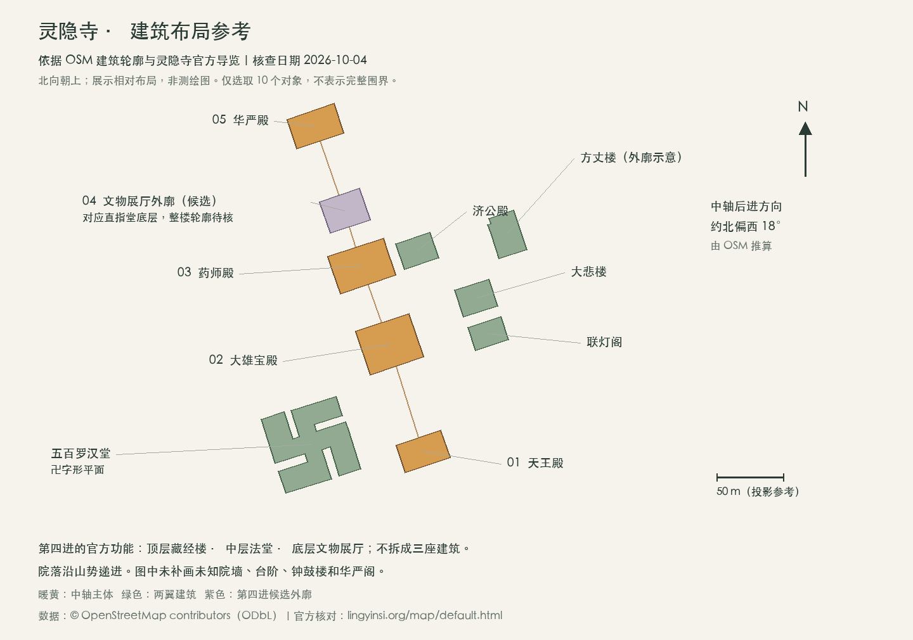

# 灵隐寺独立建模调查

核查日期：2026-10-04。范围为杭州灵隐寺的现状建筑群。本轮只调查与准备参考资料，未启用灵隐寺场景，也未修改网站功能或发布网站。

## 调查结论

资料已足够支持一版有依据的院落与建筑外观模型；尚不足以称为测绘复原。先校准五进中轴、两翼建筑、台地和屋顶轮廓，比先堆砌雕刻细节更重要。

图中建筑轮廓来自 OSM，北向朝上。主轴后进方向由天王殿、华严殿多边形质心推算约为真北偏西 18°，不默认正南北。该图只有 10 个选定建筑对象，不表示完整寺院围界、通行路线或实测尺寸。图中颜色只用于分类，与建筑实际颜色无关。[OSM 数据来源](https://api.openstreetmap.org/api/0.6/map?bbox=120.094,30.241,120.099,30.246)

## 布局骨架

寺院的五进中轴是：**天王殿 → 大雄宝殿 → 药师殿 → 直指堂（法堂）→ 华严殿**。院落沿山势层层递进，华严殿位于最后一进的高处。寺院背靠北高峰、面对飞来峰；飞来峰游览区、永福寺、韬光寺应保持各自的空间边界。[灵隐寺官网介绍](https://www.lingyinsi.org/detail_22_673.html)、[官方导览图](https://www.lingyinsi.org/map/default.html)

官方导览图的直指堂弹窗明确了同一建筑的三层功能：**顶层藏经楼、中层法堂、底层文物展厅**。这不是三座连续建筑。OSM 在药师殿和华严殿之间标有“灵隐寺文物展厅”，可作第四进的候选外廓；其名称不足以确认整栋直指堂的全部轮廓。[官方导览图](https://www.lingyinsi.org/map/default.html)、[OSM 文物展厅](https://www.openstreetmap.org/way/434366739)

五百罗汉堂在中轴西侧，具有明确的卍字形平面；济公殿在药师殿东侧。联灯阁、大悲楼、方丈楼也有 OSM 命名建筑轮廓。钟鼓楼位于天王殿两侧，西为鼓楼、东为钟楼，其外廓尚待补齐；华严阁位置仍待核。[官方罗汉堂导览](https://jp.lingyinsi.org/list_168.html)、[官方济公殿导览](https://jp.lingyinsi.org/list_167.html)、[官方钟鼓楼导览](https://jp.lingyinsi.org/list_161.html)、[布局与对象索引](./lingyin-layout-sources.md)

## 建筑外形的重点

| 建筑 | 当前可用的建模依据 | 仍待核实 |
|---|---|---|
| 天王殿 | 第一进入口殿；两块醒目门匾 | 外廓尺度、柱网、檐口与台基 |
| 大雄宝殿 | 官方殿高 33.6 m；面阔七间、进深四间；单层殿身、三重歇山与翘檐。官方导览示意画面可辨三道檐线 | 每道屋面的尺寸、坡度、出檐；柱径和斗拱做法 |
| 药师殿 | 单层重檐歇山；面阔七间、进深三间 | 建筑高度、檐出、台阶与台基标高 |
| 直指堂 | 藏经楼／法堂／文物展厅的上下功能关系 | 各层标高、底层是否半地下、屋顶细部 |
| 华严殿 | 第五进、高处的末端主殿 | 建筑高度、柱网与屋顶细部 |
| 五百罗汉堂 | 卍字形，面积约 3116 ㎡，中央高度约 25 m，清式双檐外观 | 面积与高度测量基准、各翼尺寸 |
| 济公殿 | 药师殿东侧的附属殿 | 外部屋顶、层数与米制尺寸 |

主体殿堂数据参见[官网建筑介绍](https://www.lingyinsi.org/detail_44_7946.html)；罗汉堂数据参见[官方专题](https://www.lingyinsi.com/detail_13929.html)。详细来源、历史与现状区别见[建筑结构调查](./lingyin-building-structure.md)。大雄宝殿“单层”不等于只有一道檐，三道檐也不等于三层楼。日文导览对重檐的表述较概括，具体工程结构仍需照片和图纸复核。

## 后续建模顺序

1. **院落体量**：根据已核轮廓放置五进主体和两翼，校对真实朝向、建筑间距与台地关系；高差只作明确标注的近似表达。
2. **识别性外观**：优先大雄宝殿的三重屋顶、药师殿重檐、罗汉堂卍形和直指堂楼层关系，再加柱廊、门窗、匾额与院落树木。
3. **景点接入**：沿用雷峰塔、三潭印月的独立场景生命周期、热点与往返渐变；模型可单独查看，不需要重构西湖地形场景。

首版建议以建筑群外观为范围。佛像、壁塑、内部梁架和修缮级构件需要另一轮资料；本轮未找到可直接复用的整寺 CAD、点云或现成完整 3D 模型。官方导览图是示意参考，不能将其像素换算为经纬度、建筑高度或实测柱网。

## 本轮产物

- [布局与来源](./lingyin-layout-sources.md)：主轴、两翼、环境边界、OSM 对象及待核项。
- [建筑结构调查](./lingyin-building-structure.md)：殿堂形制、尺寸字段及来源冲突。
- [建筑轮廓数据](./lingyin-building-footprints.geojson)：10 个选定对象，WGS84，保留 OSM ID、版本、时间与原始标签；遵循 ODbL。原始 `building:levels` 等标签不代表已核实的楼层数或模型参数。
- [可缩放布局参考图](./lingyin-layout-reference.svg)：由上述轮廓绘制，不是测绘图。

核验：官方导览图的“大雄宝殿”“直指堂（法堂）”“华严殿”标注已在浏览器实际点读；OSM 的 10 个对象已核查为闭合多边形，并检查了参考图的朝向、文字和引线。未运行应用 build 或测试，因为本轮仅新增调查文档与参考数据。
